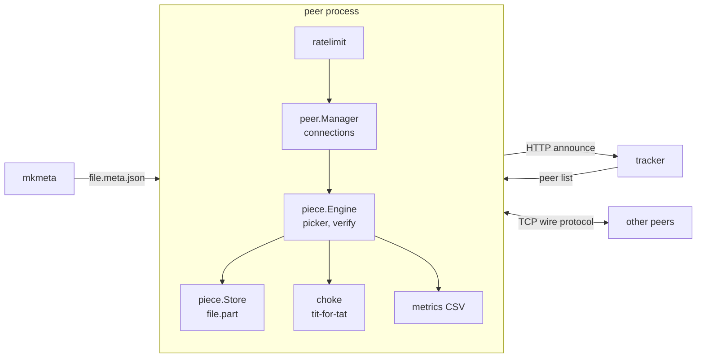
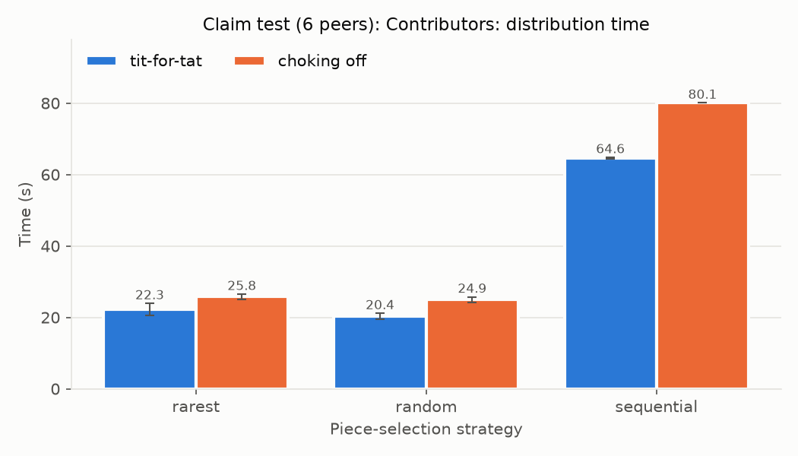
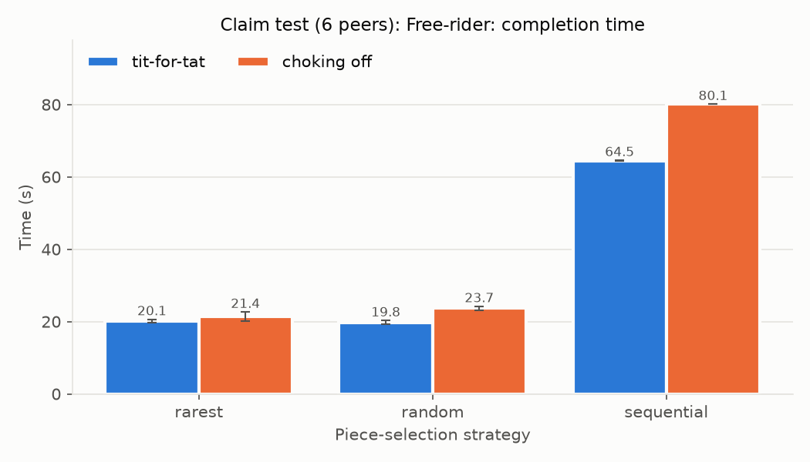
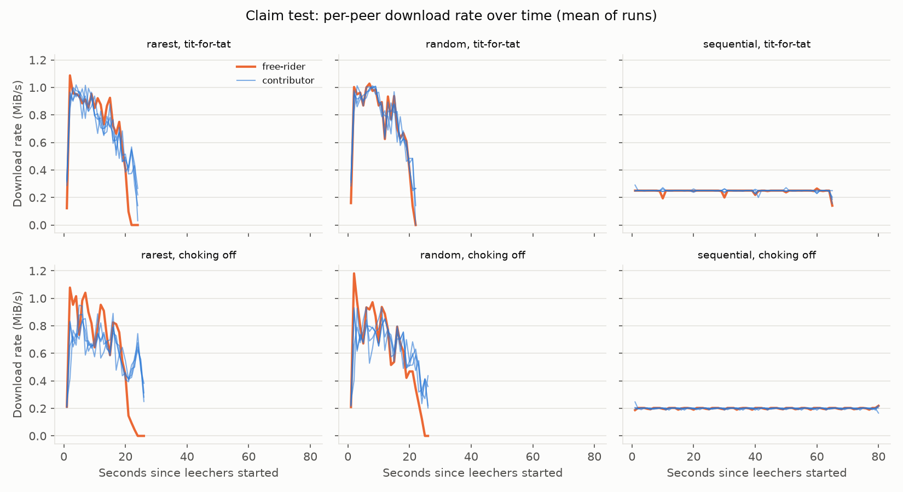
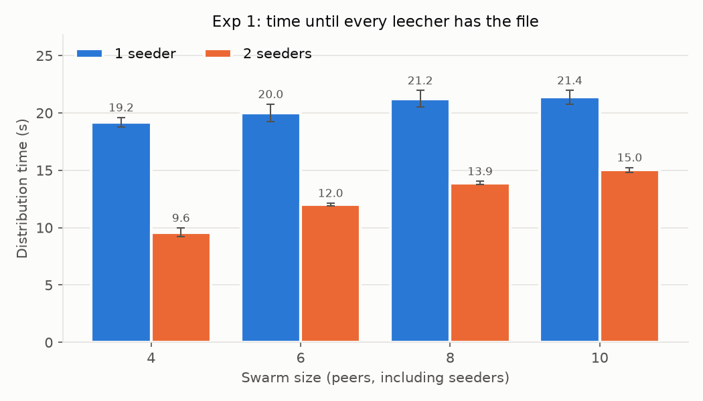
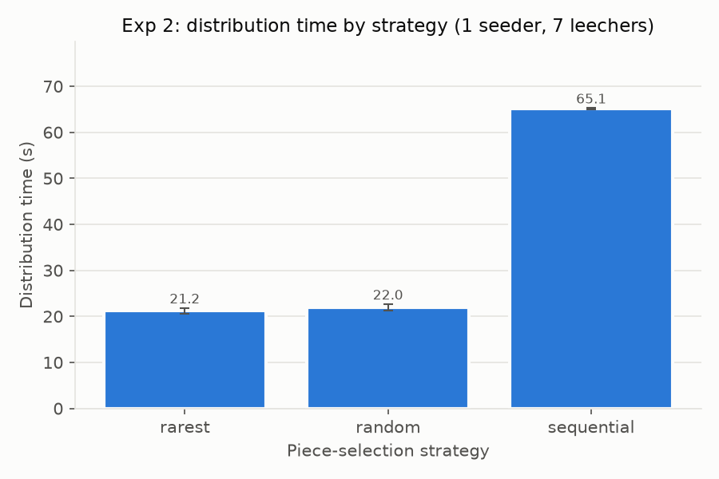
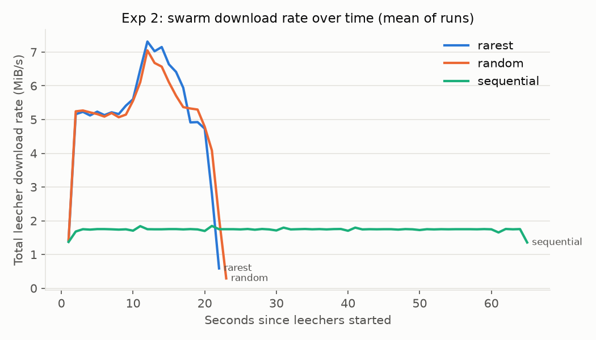
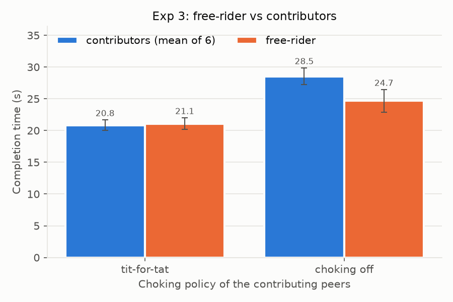

# ShardSwarm technical report

| | |
|---|---|
| Course | CS-30003 · Coding Assignment 1 |
| Section | CS-33 |
| Project | P8 · P2P File Distribution (BitTorrent-lite), Path A (Catalogue) |
| Team | Sneha Ram (24155808) · Aditya Giri (24155747) · Rishav Sarkar (24155946) · Swayam Kanjilal (24155814) |
| Repository | https://github.com/sneharam543/shardswarm |

## Team and work split

The split follows section 5 of the project proposal. Every source file names its owner in its header.

| Member | Area (from the proposal) | Files |
|---|---|---|
| Sneha Ram | Metainfo & Tracker: metainfo format, per-piece SHA-256 hashing, tracker server, swarm membership, peer-list serving | `internal/metainfo/`, `cmd/mkmeta/`, `internal/tracker/`, `cmd/tracker/`, [METAINFO.md](METAINFO.md), [TRACKER_API.md](TRACKER_API.md) |
| Aditya Giri | Peer Wire Protocol: handshake and message framing over raw TCP; owns the written protocol specification | `internal/wire/`, [PROTOCOL.md](PROTOCOL.md) |
| Rishav Sarkar | Download Engine & Concurrency: rarest-first selection, request pipelining, on-receipt hash verification, per-peer state machines across the swarm | `internal/piece/engine.go`, `internal/piece/store.go`, `internal/peer/`, `cmd/peer/` |
| Swayam Kanjilal | Choking & Experiments: tit-for-tat choking, the free-rider peer and experiment, rate limiting, all plotted analysis | `internal/piece/choke.go`, `internal/ratelimit/`, `internal/metrics/`, `experiments/` |
| All | Integration, plots, report, viva preparation (proposal week 8) | this report, `README.md` |

## Summary

ShardSwarm is a peer-to-peer file distribution system in the style of BitTorrent. It is written in Go with no third-party libraries.
- **Built from scratch:** an HTTP tracker, a binary peer wire protocol over TCP, SHA-256 verification of every piece, rarest-first, random and sequential piece selection with request pipelining, tit-for-tat choking with optimistic unchoke, a token-bucket upload limiter, and per-peer CSV metrics.
- **Tested:** 83 tests and fuzz targets pass under Go's race detector, including one that runs six real peer processes against a live tracker.

All results are measured, over 5 repeats per configuration, on one PC with a 1 MiB/s upload cap per peer.
- **The proposal's claim, tested as designed (6 peers, strategy × choking):**
  - **Faster distribution: supported.** Rarest-first with tit-for-tat (22.3 s) beat random (24.9 s) and sequential (80.1 s) with no choking. The gain comes from choking: random with tit-for-tat was as fast or faster (20.4 s).
  - **Penalising the free-rider: not supported.** It finished 2.0 s before the average contributor even under tit-for-tat. Tit-for-tat only halved its lead.
- **P2P scales.** With one seeder, tripling the leechers from 3 to 9 added 2.2 s (19.2 s to 21.4 s), against a theoretical floor of 16 s.
- **Piece order matters.** Sequential selection took 65.1 s, about 3 times longer than rarest-first (21.2 s) or random (22.0 s). Rarest-first and random are not distinguishable at this swarm size.
- **Tit-for-tat helps contributors but does not punish a free-rider.** It cut the contributors' time from 28.5 s to 20.8 s compared with choking switched off, but the free-rider finished as fast as they did (21.1 s). In a 30-run follow-up study with a 64 MiB file, it finished about 10 s ahead of them, and two candidate fixes did not change that.

## Requirements coverage

| Requirement | Where | Evidence |
|---|---|---|
| Fixed-size pieces, per-piece SHA-256, documented metainfo format, empty files and short last piece handled | `internal/metainfo`, [METAINFO.md](METAINFO.md) | `TestBuild` (5 file shapes), `TestLoad_Rejects` (21 malformed files), `FuzzLoad` |
| Tracker with announce, scrape, expiry, duplicate IDs, concurrency | `internal/tracker`, [TRACKER_API.md](TRACKER_API.md) | `TestTracker_*` (11 tests), including 50 concurrent clients under `-race` |
| Custom wire protocol: handshake, bitfield, have, request, piece, cancel, framing, limits | `internal/wire`, [PROTOCOL.md](PROTOCOL.md) | Exact-byte tests, 21 invalid-message cases, `FuzzRead` (3.1 million inputs, no failure) |
| Concurrent connections, per-peer state, timeouts, disconnects, no leaks | `internal/peer` | `TestManager_*`, `TestConn_*`, goroutine-count leak test |
| Rarest-first, random, sequential, pipelining, verification, reconstruction | `internal/piece` | `TestEngine_PickPiece`, `TestEngine_SwarmDownload` (byte-identical output), corrupt and stalled peer tests |
| Seeder and leecher roles, at least 6 concurrent peers | `cmd/peer` | `TestSwarm_SixProcesses`: 6 OS processes, tracker reports 6 complete |
| Choking: tit-for-tat, optimistic unchoke, free-rider mode | `internal/piece/choke.go` | `TestPickUnchoked*`, `TestEngine_FreeRiderNeverUploads` |
| Bandwidth limit on real transfer writes | `internal/ratelimit`, `pacedWriter` in `internal/peer/peer.go` | `TestLimiter_*` (100% coverage), `TestEngine_UploadLimitGovernsDownloadTime` |
| Docker and Compose (optional deployment) | `deploy/Dockerfile`, `docker-compose.yml` | Compose file validated, commands run outside Docker; **image not yet built or run** (see limitations) |
| The proposal's claim experiment: 6 peers, strategy × choking, free-rider, per-peer rate | `experiments/run.py` (`claim`), `experiments/analyze.py` | 30 runs; [Testing the proposal's claim](#testing-the-proposals-claim) |
| Experiments, CSV, plots | `experiments/`, `internal/metrics` | 30 claim runs, 65 additional runs, 30 follow-up runs |

## Architecture

Three programs share one module. File data only ever moves between peers; the tracker only introduces them.

| Component | Package | Responsibility |
|---|---|---|
| Metainfo | `internal/metainfo`, `cmd/mkmeta` | Splits a file into 256 KiB pieces; the info hash (SHA-256 of the canonical description) identifies the swarm |
| Tracker | `internal/tracker`, `cmd/tracker` | Swarm membership over HTTP; IP taken from the connection; peers expire after two missed intervals |
| Wire protocol | `internal/wire` | 64-byte handshake, then length-prefixed frames; validates every field against the metainfo |
| Connections | `internal/peer` | One reader and one writer goroutine per peer, strikes, timeouts, one connection per pair |
| Engine and store | `internal/piece` | Piece selection, pipelining, hash check, writing `file.part`, rename on completion, serving requests |
| Choking | `internal/piece/choke.go` | Chooses the 4 peers that may download from this peer |
| Rate limiter | `internal/ratelimit` | Token bucket for uploaded piece data |
| Metrics | `internal/metrics` | Appends CSV rows: verified pieces, 1 s rate samples, completion |

The byte layouts, message rules and API contracts live in [METAINFO.md](METAINFO.md), [TRACKER_API.md](TRACKER_API.md) and [PROTOCOL.md](PROTOCOL.md). This report does not repeat them.

## Design decisions

Each decision lists what it costs.

| Decision | Why | Cost |
|---|---|---|
| Blocks on a fixed 16 KiB grid; partial or misaligned requests are invalid | A block is identified by (piece, offset) alone, which keeps request tracking and validation small | Not wire-compatible with real BitTorrent, which allows any block size; irrelevant because both ends are ours |
| Each in-progress piece is owned by one peer, which supplies all its blocks | A failed hash check blames exactly one peer; a choke, disconnect or 30 s stall simply returns the piece to the pool | Up to one piece of work is discarded per such event; no parallel fetching of a single piece |
| Either peer may dial; of two connections to the same pair, the one dialled by the lower peer ID survives | Both sides compute the same rule, so they keep the same TCP connection without coordination | A duplicate connection is briefly opened and closed when both peers dial at once |
| `Send` never blocks; a peer whose 256-message queue is full is disconnected | The engine sends while holding its lock, so a blocking send could deadlock the whole peer | A briefly slow but honest peer can be dropped |
| One mutex for all engine state | Simple and race-free at the target scale of tens of peers | Block reads and piece writes happen under the lock; would limit hundreds of peers |
| Token bucket reserves tokens and sleeps on one timer for the deficit | No busy-waiting; concurrent writers queue fairly; cancelled waits refund their tokens | Throughput within a 20 ms burst is unpaced |
| Only Piece frames count against the upload cap | Control messages are a few bytes; capping them made a Have message wait 951 ms behind queued data (measured by test) | Control traffic is unlimited; negligible in volume |
| Download written to `name.part`, renamed only when every piece is verified | A partial download never looks complete; an unrelated file with the same name is never overwritten | No free-disk-space check before starting (no portable standard-library call) |
| Upload slots and rank ties go to peers that have given us the most bytes over the whole connection | A contributor that had one quiet round still outranks a peer that never gave anything | No measurable effect in an 8-peer swarm (see the free-rider study) |

## Correctness and concurrency

- **Goroutines:** every connection has exactly one reader and one writer goroutine. Shutdown goes through `context.AfterFunc` on each socket, so cancelling a peer closes every connection at any stage, including those mid-handshake. A test counts goroutines before and after shutdown.
- **Race detection:** the full suite runs under `go test -race`. The timing-sensitive packages were also repeated 10 to 40 times without failure.

Testing and code review found five real bugs. Each is fixed, with a regression test that fails without the fix:

| Bug | Effect | Fix |
|---|---|---|
| `WaitGroup.Add` could race with `Wait` during shutdown | A connection accepted at shutdown could leak or panic | All connection goroutines start through one `spawn` helper under the manager lock |
| A silent peer won back its own timed-out pieces | The last pieces could stall for a long time; failed 1 in 10 test runs | A stalled owner gets a strike and is skipped for that round |
| Peers that finished kept their upload slots until the next rechoke | Every download ran about 10 s longer | Slots are counted only for interested peers and refilled at once |
| Only the lower peer ID was allowed to dial | A late joiner with the highest ID waited up to one tracker interval (15 s) | Both sides dial; the lower-ID tie-break removes duplicates |
| A failed final rename left the store reading from a closed file | The peer could neither finish nor seed | On failure the `.part` file is reopened and seeding continues |

## Security

All peer input is untrusted, and is handled as follows:
- **Before use:** every length, piece index and offset is checked against the trusted metainfo, with offset arithmetic in 64 bits.
- **Before allocation:** frame lengths are checked first. Malformed frames cost the sender a strike, and three strikes disconnect it.
- **File names:** the name from the metainfo is validated so it cannot leave the download directory; Windows device names such as `NUL` are rejected.
- **Unverified data:** a peer is never served bytes from pieces we have not verified and announced.
- **Tracker:** it takes the client IP from the connection, accepts "stopped" only from the peer's own address, and caps swarms and peers.

Out of scope, by design, for a trusted private network:
- no encryption and no peer authentication (a peer ID is a claim);
- no tracker rate limiting;
- no proof of who published a file. SHA-256 gives integrity, not authenticity.

The full list with mitigations is in [KNOWN_ISSUES.md](KNOWN_ISSUES.md).

## Testing

| Package | Statement coverage |
|---|---|
| `internal/metainfo` | 94.9% |
| `internal/metrics` | 96.8% |
| `internal/peer` | 94.7% |
| `internal/piece` | 93.5% |
| `internal/ratelimit` | 100.0% |
| `internal/tracker` | 98.1% |
| `internal/wire` | 100.0% |

The code is 2,582 lines of Go, and its tests are 2,895 lines.

The integration tests use real TCP on loopback and real processes:
- **Six processes:** `TestSwarm_SixProcesses` re-executes the test binary as six peer processes against a live tracker. It checks byte-identical output, the tracker's scrape count, and each peer's metrics CSV.
- **Fuzzing:** `FuzzLoad` and `FuzzRead` check that no input crashes the parsers, and that every accepted wire message re-encodes to the same bytes.

## Testing the proposal's claim

**The claim (proposal, section 3):** "a rarest-first piece selection policy combined with tit-for-tat choking completes distribution faster and penalizes non-contributing peers more effectively than random or sequential selection with no choking."

**Verdict:**
- **(a) "Completes distribution faster": supported, but the speed comes from choking, not from rarest-first.** Rarest-first with tit-for-tat (22.3 s) beat random with choking off (24.9 s) and sequential with choking off (80.1 s). However, random with tit-for-tat was the fastest combination (20.4 s), and its range overlaps rarest-first with tit-for-tat.
- **(b) "Penalizes non-contributing peers more effectively": not supported.** Under every combination with tit-for-tat, the free-rider finished no later than the average contributor. Tit-for-tat only shrank the free-rider's lead.

### Method

The design follows the proposal:
- **Fixed controls:** a swarm of **6 peers** (1 seeder, 4 contributing leechers, 1 injected free-rider), a 16 MiB file, a 1 MiB/s token-bucket upload cap on every peer, and 256 KiB pieces.
- **Independent variables:** piece-selection strategy (rarest-first, random, sequential) and choking policy (tit-for-tat on, choking off), in every combination.
- **Repeats:** 5 per combination, 30 runs in total, each with a fresh tracker.
- **Metrics:** total distribution time (until the last contributor finishes), per-peer download rate over time, and the free-rider's completion time. The free-rider is compared with the average contributor, so that a single peer is compared with a single peer.

Raw data is in `experiments/results/claim/`, and the table in [summary.md](../experiments/results/summary.md).

### Results

| Strategy | Choking | Distribution time (last contributor) | Average contributor | Free-rider | Free-rider minus average contributor |
|---|---|---|---|---|---|
| Rarest-first | tit-for-tat | 22.3 ± 1.7 s | 22.1 ± 1.6 s | 20.1 ± 0.5 s | −2.0 s |
| Rarest-first | off | 25.8 ± 0.7 s | 25.7 ± 0.7 s | 21.4 ± 1.2 s | −4.3 s |
| Random | tit-for-tat | 20.4 ± 0.8 s | 20.2 ± 0.7 s | 19.8 ± 0.5 s | −0.5 s |
| Random | off | 24.9 ± 0.8 s | 24.7 ± 0.8 s | 23.7 ± 0.6 s | −1.1 s |
| Sequential | tit-for-tat | 64.6 ± 0.3 s | 64.4 ± 0.2 s | 64.5 ± 0.1 s | +0.1 s |
| Sequential | off | 80.1 ± 0.0 s | 80.0 ± 0.0 s | 80.1 ± 0.0 s | +0.1 s |

### Discussion

- **Choking on is faster for every strategy.** With choking off, an uploader serves every interested peer at once, so each connection gets a thin share of its 1 MiB/s and pieces complete slowly. Tit-for-tat concentrates each uploader's bandwidth on 4 peers.
- **The sequential rows match theory exactly, a useful check on the whole setup.** Every sequential leecher wants the same next piece, so almost everything comes from the seeder:
  - with choking off, its 1 MiB/s is split 5 ways, so 16 MiB takes **80 s** (measured 80.1 s);
  - with tit-for-tat, it serves 4 peers at a time, so 16 MiB takes **64 s** (measured 64.6 s).
- **Rarest-first versus random:** the 1.9 s difference with tit-for-tat is within the overlap of their ranges. With 6 peers that join together and stay, no piece is ever truly rare.
- **The free-rider:** the per-peer rate chart shows that, with choking off, the free-rider downloads faster than the contributors early in the run. Tit-for-tat brings its rate down to theirs, which cut its lead from 4.3 s to 2.0 s (rarest-first) and from 1.1 s to 0.5 s (random).
  - It is never pushed *below* the contributors.
  - With 6 peers there are only 5 interested peers per uploader for 4 upload slots, so tit-for-tat has almost nothing to withhold.
  - The follow-up study (below) reached the same conclusion with larger files and two candidate fixes. A larger swarm, where slots are scarce, is the untested next step.

## Additional experiments

These go beyond the proposal: swarm size and seeder count, the strategy comparison and the free-rider in an 8-peer swarm, and the follow-up study.

### Method

`experiments/run.py` starts every peer as a separate operating-system process, with a fresh tracker for each run.

**Held fixed in every run:**
- the same 16 MiB payload, generated from a fixed seed;
- a 1 MiB/s upload cap on every peer;
- 256 KiB pieces;
- a 2 s tracker interval;
- 5 repeats per configuration.

**What is measured:** distribution time, from the moment the leechers start until the last leecher has verified the whole file. Each run is saved as soon as it ends, and an interrupted batch resumes. `experiments/analyze.py` computes the mean and sample standard deviation and draws the charts. The raw data is under `experiments/results/`, and the full tables are in [summary.md](../experiments/results/summary.md).

### Experiment 1: swarm size and seeder count

| Swarm (peers) | 1 seeder | 2 seeders |
|---|---|---|
| 4 | 19.2 ± 0.4 s | 9.6 ± 0.4 s |
| 6 | 20.0 ± 0.8 s | 12.0 ± 0.1 s |
| 8 | 21.2 ± 0.7 s | 13.9 ± 0.1 s |
| 10 | 21.4 ± 0.6 s | 15.0 ± 0.2 s |

**Lower bounds:** every leecher must receive 16 MiB, and the peers' combined upload is (seeders + leechers) × 1 MiB/s. That gives two bounds:
- the seeders alone must send the file at least once: 16 s with one seeder, 8 s with two;
- the swarm's combined upload must deliver every leecher's copy.

**With one seeder,** the seeder bound dominates, and the measured times stay within 1.2 to 1.4 times of 16 s while the leechers triple. Leechers upload to each other, so the seeder does not need to send a full copy to each one.

**With two seeders,** small swarms finish in about half the time (9.6 s against an 8 s bound). For larger swarms the combined-upload bound takes over (12.8 s for 2 seeders and 8 leechers), so the advantage of a second seeder shrinks.

### Experiment 2: piece-selection strategy

1 seeder and 7 leechers, tit-for-tat.

| Strategy | Distribution time |
|---|---|
| Rarest-first | 21.2 ± 0.6 s |
| Random | 22.0 ± 0.7 s |
| Sequential | 65.1 ± 0.2 s |

**Sequential is about 3 times slower.** All leechers want the same next piece, so they rarely hold anything the others lack, and almost every piece has to come from the seeder. The rate chart shows the swarm's total download rate flat at about 1.7 MiB/s, while rarest-first and random climb to about 7 MiB/s.

**Rarest-first and random cannot be told apart here.** Rarest-first was 0.8 s faster on average, but their ranges overlap (20.8 to 22.3 s against 21.0 to 22.9 s). In a swarm of 8 peers that all join at once and stay, rarity differences are small. Rarest-first is expected to matter when peers leave or join over time, which these experiments do not model.

### Experiment 3: free-rider

1 seeder, 6 contributing leechers and 1 free-rider (a peer that never uploads).

| Choking policy | Contributors (mean of 6) | Free-rider |
|---|---|---|
| Tit-for-tat | 20.8 ± 0.8 s | 21.1 ± 0.9 s |
| Choking off | 28.5 ± 1.3 s | 24.7 ± 1.8 s |

**Tit-for-tat made the contributors 27% faster** than choking switched off. With choking off, every interested peer is served at once, so each connection gets a small share of an uploader's bandwidth and pieces take longer to complete.

**Tit-for-tat did not punish the free-rider.** It finished as fast as the contributors, and with choking off it finished 3.9 s *before* them.

#### Follow-up study

Earlier code showed the free-rider finishing *ahead* even under tit-for-tat, so a separate study tested the obvious explanations one change at a time. It used a 64 MiB file and runs of 70 to 90 s, which is 7 to 9 rechoke rounds, with 30 runs in total. Details are in [freerider-study/README.md](../experiments/results/freerider-study/README.md).

| Step | Change | Tit-for-tat: contributors / free-rider |
|---|---|---|
| 1 | longer runs only | 79.9 s / 70.5 s |
| 2 | free slots and rank ties go to peers that have given us the most | 76.5 s / 70.5 s |
| 3 | step 2 plus only Piece data counting against the upload cap | 81.8 s / 71.2 s |

- **Run length is not the cause.** With runs four times longer, the free-rider still finished about 10 s first.
- **Neither code change altered the outcome.** Both are kept because they are correct behaviour; the second also removes a measured 951 ms delay on control messages.
- **The remaining explanation is untested and is a hypothesis only.** In an 8-peer swarm, each contributor has about 6 interested peers competing for 4 upload slots, so the free-rider is served most of the time anyway. Tit-for-tat can only withhold something when slots are scarce.
- **Why the free-rider is sometimes faster than the contributors, rather than equal, was not measured** and is not explained.

## Limitations

- **Docker is optional and not exercised:** the image has not been built or run. The demo and all measurements use local processes. The Compose file is validated, and its commands were run successfully outside Docker.
- **Single machine:** all measurements come from one PC over loopback, with the rate limiter standing in for network bandwidth. There is no latency, loss or heterogeneous bandwidth.
- **No endgame mode:** the last piece waits for its single owner or the 30 s stall timeout.
- **Tracker list capped at 50:** swarms beyond 51 peers may not become fully connected.
- **Swarm sizes:** the experiments cover 4 to 10 peers. Tit-for-tat's behaviour in larger swarms, where upload slots are scarce, is untested.

## Conclusions

- **The system meets the mandatory requirements, demonstrated with local processes; the Docker deployment is provided as an optional step and has not been run.** It distributes a file across at least six concurrent peers with every piece verified. Every copy compared byte for byte, in the tests and the demos, matched the source. In the experiments, every piece of every copy passed its SHA-256 check.
- **Peer-to-peer distribution scales as theory predicts.** Distribution time stays near the seeder's lower bound as the swarm grows, and a second seeder roughly halves it for small swarms.
- **Piece order is the largest effect measured.** Sequential selection is about 3 times slower. Rarest-first and random are equivalent at this scale.
- **The proposal's claim is half supported.** Rarest-first with tit-for-tat does complete distribution faster than random or sequential selection with no choking, but the gain comes from choking: random with tit-for-tat was equally fast. Tit-for-tat does **not** penalise the free-rider in swarms of 6 or 8 peers. It shrinks the free-rider's lead without reversing it. The most plausible reason, too few peers for upload slots to be scarce, is a hypothesis for future work.

## Reproducing

Commands for building, the local demo, the experiments and the optional Docker setup are in the [README](../README.md). The experiment settings of each batch are stored in `experiments/results/<exp>/settings.json`.
